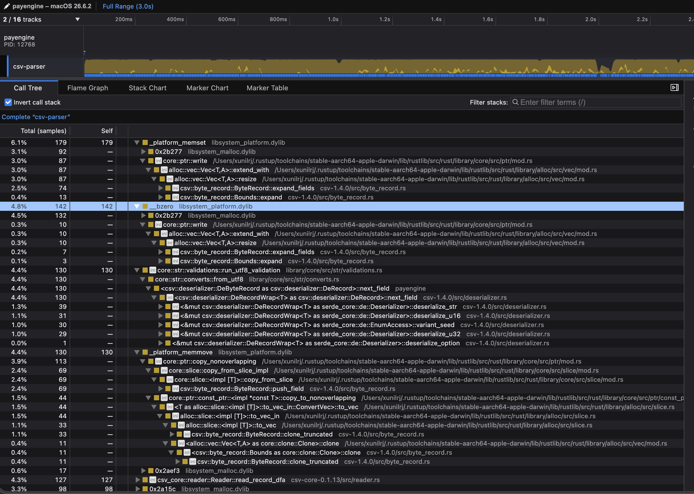

# TLDR

Deliberate spec interpretations (details in the devlog below):

- Locked accounts ignore all further transactions. Spec is not clear on what to do with locked accounts; I chose the "fully frozen" bank reading;
- Spec calls `chargeback` the end of a dispute. It is not clear this means nothing else can happen. I return the transaction to the `Normal` state, but with the client locked, nothing can happen anyway;
- Amounts are output with natural precision (`2`, `1.5`), and are not forced to 4 decimal places. Spec contradicts itself; round values are explicitly accepted either way.
- The spec only describes disputes on deposits. A disputed withdrawal only flags the transaction (nothing moves to `held`), and its chargeback refunds the amount to `available` and locks the client;
- The redundant client id in dispute/resolve/chargeback is used to verify the transaction owner. With more than one shard the tx will possibly end in the wrong shard, and it will be ignored with "tx not found" instead;
- Invalid rows (bad type, negative amount, etc.) are reported, skipped, and the file continues to be processed; the application exits `0` and prints a summary of skipped rows to stderr;
- Amounts of zero are valid transactions: recorded like any other, and can be disputed/charged back (a zero chargeback still locks the client);
- Insufficient-funds withdrawals and duplicated tx ids are ignored as business outcomes, never fatal.
- A dispute can drive `available` negative: deposit 10, withdraw 8, dispute the deposit and `available` becomes -8 with 10 held. This is the norm in banks: the account is overdrawn, not frozen. We cannot lock the account, we want the user to be able to deposit more money and recover.


# Testing

Everything is run with a single command:

```sh
cargo test
```

There are two layers:

- Unit tests: next to the code they test.
- E2E snapshot tests: under `tests` folder. They compile the release binary and run it against every `*.csv` and `*.toml` file under the same folder. Each run generate a snapshot file and compare them with `insta`.

The fixtures are organized by what they test:

- `tests/ok/` — valid inputs;
- `tests/nok/` — invalid inputs;
- `tests/cli/` — CLI misuse;
- `tests/sharding/` — shard tests;
- `tests/blocks/` — block splitting.

When a change is intentional, new snapshots can be accepted with `just accept-tests`.

# Benchmarks

Benchmarks can be run with: 

Everything is run with a single command:

```sh
just bench
just bench-memory
```


# Configuration

The CLI takes the input file as its only argument. Everything else is optional and set through environment variables:

| Variable | Default | Effect |
|---|---|---|
| `PAYENGINE_SHARDS` | half the cores | Number of engine shards. Each client always goes to shard `client % shards`. |
| `PAYENGINE_PARSERS` | half the cores | Number of CSV parser threads. |
| `PAYENGINE_BLOCK_SIZE` | `65536` | Bytes of input per parsed block. |
| `PAYENGINE_SORT_OUTPUT` | unset | When set, output rows are sorted by client. Otherwise they come in any order, which the spec allows. The tests set it. |
| `RUST_LOG` | `error` | Log filter. `warn` shows every ignored transaction, `trace` every parsed one. |
| `RUST_LOG_NO_TIMESTAMP` | unset | When set, log lines have no timestamp. The tests set it. |

The three numeric variables must be positive integers; anything else stops the run with an error and exit code `1`. Logs and error reports go to stderr; stdout only ever contains the output CSV.

# Plan

This solution will be done using the following plan:
1 - Minimal e2e working example;
2 - e2e snapshot framework;
3 - Using the test framework, implement all features;
4 - Improve the architecture/code;
5 - Improve the performance;

# AI

I will use AI in the following steps:

1 - Transform the spec to a AI digestible markdown;
2 - Use the MD to check all features are implemented;
3 - Search for bugs and problems;
4 - Help with the test framework and writing and document tests;

# Devlog

I will try to create here the most realistic devlog of the steps I took whilst developing this solution.

## First step

I will expedite a minimal example working. That means that code does not need to be good. I just want something working e2e. In this case will be a simple CLI parsing a one-line CSV and printing the output.

## Test framework

Now that we can process the simple CSV file, I want to create the test framework. Although I do see the value of "unit tests", in this case, I think e2e snapshot tests will be a better fit. Why? Because they will be visually simpler to understand what they are testing, and their final result.

For that I will use `insta` and `libtest-mimic`. That means that a simple `cargo t` will run all tests as normal.

A "polemic" decision is why use `cargo r` to run the app, and not call a function inside the crate directly. There are disadvantages of calling the compiled exe for sure, but there are also advantages: we can run test in parallel more easily; one crashing test does not kill others; we can capture log and put in the snapshot etc...

It is a little bit ugly, I will give you that, but is something I already use in other repos, and is something I like.

## Quick fix to remove branding

I used AI to create the recipe `search-history` to help me certify no branding exists in the repo.

## Basic Implementation

The basic implementation is done. Now I will use AI to find missing spots and improve the spec coverage. I will not focus on code quality yet.

I am still trying to implement everything that was asked.

I would normally NOT commit ROADMAP.md because it is a temporary artifact generated by AI, but I will here to show AI usage. I asked AI (claude + ollama with GLM 5.2) to generate a roadmap where the implementation does not follow the spec. It found a couple of points. I normally discuss some points and settle on something. I then use this document as a guide. Not necessarily implement everything in order. And if the task is small enough I can ask claude to do it. It all depends.

I will remove this file when it is complete. Again I would never do this in practice, but it is as transparent as I can make AI usage to be for this test.

And when creating this ROADMAP.md two points popped out when discussing with claude:
1 - It is not clear that chargeback should put the transaction in a "final state", that means this transaction cannot be disputed anymore. I went with the safe choice of returning the transaction to `Normal`;
2 - It is not clear what to do with a locked/frozen account. Should we ignore operations to it? I am also going with the safe option here, although this one seems wrong.

ROADMAP.md was introduced in the commit 6b67a69.

## Removing timestamps from snapshots

I forgot to remove log timestamps from snapshots, making them non deterministic. This is fixed now.

## Disputes on withdrawals

The spec is not very clear on what to do on `withdrawals`. So the best implementation I found is: deposits move funds to `held` as the spec says; a disputed withdrawal only flags the tx without moving balances (keeping `held` non-negative), and its chargeback refunds the amount to `available` and locks the account.

This deviates a little from the spec `chargeback` wording ("total should decrease"). My reading is that
the spec is focused in describing `deposit`. Because it would not make sense to "decrease total" when refunding
a disputed withdrawal.

## Redundant Client ID

Some messages seems to have redundant Client ID. Spec is not entirely clear what to do with them. I decided to use them to check everything is fine and generate warnings when not.

## f32 -> Decimal

Now we are going to improve the issue of precision of `f32`. I decided to use `rust_decimal` as it is a well known crate with 28 digits. This is NOT enough in some pairs, BTC to some meme coin, for example. In this case it may be worth to use an "infinite precision" decimal. But for this case it is enough.

But using `Decimal` alone was not enough. CSV has no types, so the `csv` crate guesses each field's type (integer, then float, then string), and the default `Decimal` deserializer accepts whatever was guessed. Amounts were therefore parsed as `f64` first and silently corrupted beyond ~15-17 significant digits, before the engine even saw them:

```
12345678901234.5678            -> 12345678901234.568
79228162514264337593543950335  -> rejected (integer too big for the guessed types)
```

The fix is `rust_decimal`'s `serde-str` feature, made for untyped formats like CSV: `Decimal` always deserializes from the field's text, so amounts are parsed exactly. A visible side effect is that amounts keep the scale they were written with, so `1.0` is printed as `1.0` instead of `1`. The value is the same, and the spec explicitly accepts both.

## User friendly error

It was not asked but I decided to return more user friendly errors, because it is one thing I believe is very important.

I also decided to reject extra CLI arguments: the spec expects the input file as the sole argument, so anything more is a usage error (exit `1`) instead of being silently ignored.

## Changing user id and tx id types

Now I changed user id and transaction id to the suggested types. That enticed me to consider changing the accounts `BTreeMap` to a simple pre allocated `Vec`. `O(1)` access, but this is far from being the bottleneck and will almost always use more memory. I decided to keep the `BTreeMap`: it is simpler, sorted output for free, and memory scales with the number of clients seen, not with the whole `u16` range.

I have also considered what to do with the transaction map. Today we are storing all of them, when we need them in memory only for dispute. Huge wasted memory. 

I consider the following solutions:
- a lazy way to restore a transaction when a dispute starts. That would be the best option in a realistic scenario. Would keep memory bounded and very low, as I imagine disputes are not very common. This seems too complex for a toy project like this. It can scare the reviewer. I decided to not pursue this, although I would for this to be memory bounded (ideal for containers etc.).
- Another option is to pre-pass the CSV and save all disputed txs beforehand and only keep them in memory. This will generate a VERY good demo, but it is not realistic, because a real engine would work with an infinite stream of transactions, that cannot be pre-processed. This seems too fake and I decided to ignore it.

## Frozen Account

I was not sure how much a frozen account needs to be really frozen. But the spec asks to resolve ambiguities the way a bank (an ATM, a transaction processor) would, and to document the choice.

So I decided to make frozen accounts to be really frozen. Now they "ignore" all transactions. I still generate a warn, but nothing else can change about them.

I was reluctant because there is no "unlock" message. But seems to be the correct thing to do.

## Improving validation

I am also not sure what is the best way to deal with invalid inputs, like negative values for deposit. I decided to report a friendly error for the bad row (pointing at the offending field) and skip it, then keep processing the file. A single malformed line does not invalidate the whole history of valid transactions, so the application exits `0` even when some rows were rejected. At the end a summary with the total number of skipped rows is printed to stderr, so a clean exit never hides that some transactions were not applied. All diagnostics go to stderr, keeping stdout clean for the output CSV.

## Output precision contradiction

The spec contradicts itself on how to display output decimals, so I had to pick one reading. On one hand, it says that how round values are displayed (and row order) is irrelevant. On the other hand, it says to assume and output four decimal places.

I am reading the second statement as: "you should be able to output at least 4 digits of precision". That means if we have something like 10.123456789, output should never truncate/round it to 10.123, because it has less precision than the grader expects. But it is not a problem to emit more, or to round 1.0000 to 1.

## Amount = Zero

I had to decide what to do with amount equals zero. It seems a trivial case, but what happens if this transaction is disputed. I decide to let these transactions exist and treat them as normal.

It seems strange a deposit of zero be disputed. And because of that  the account being locked. But with the "bank mentality", if is strange it is better to play safe and let a human look at it and see what is happening.

## Improving error handling

Now I am using anyhow and removing all unwraps.
I have also removed all unwrap/panic code from "production".

There are two `.expect()` but they will never panic as they are checked beforehand.
I tried to improve `InputCsv` to be an enum and make "None" impossible to represent, but the `csv` crate does not support this kind of serialization. That could be a strong argument to use another better crate, or to parse CSV manually. I will not do this for this test.

## Another round on precision

Only now I realized that `rust_decimal` without `serde-str` feature was parsing float values from `f64`, losing precision on the parser. Now we are doing as best we can with `rust_decimal`. I am also calling normalize just before
writing the output to simplify the final CSV.

Again for money and crypto I still think makes more sense to use an "infinite precision" decimal lib. But I think we are good for this demo.

## Performance

I will analyze performance now. This is the result of the benchmark before any changes.

```
┌─────────────────────────┬────────────────────┬──────────────┬────────────┬────────────────┐
│        Benchmark        │     Throughput     │ Median ns/op │ P95 ns/op  │     Change     │
╞═════════════════════════╤════════════════════╤══════════════╤════════════╤════════════════╡
│10k                      │          7.67 Mtx/s│        128.99│      141.00│               -│
│100k                     │          6.06 Mtx/s│        163.78│      170.96│               -│
│1M                       │          5.37 Mtx/s│        185.40│      188.86│               -│
│10M                      │          4.94 Mtx/s│        202.14│      203.14│               -│
│100M                     │          4.11 Mtx/s│        238.04│      252.17│               -│
└─────────────────────────┴────────────────────┴──────────────┴────────────┴────────────────┘

size       peak RSS
10k           26 MB
100k          26 MB
1M            58 MB
10M          510 MB
100M        4803 MB
```

Changing the transaction map from `BTree` to `HashMap` improved performance.

```
┌─────────────────────────┬────────────────────┬──────────────┬────────────┬────────────────┐
│        Benchmark        │     Throughput     │ Median ns/op │ P95 ns/op  │     Change     │
╞═════════════════════════╤════════════════════╤══════════════╤════════════╤════════════════╡
│10k                      │         10.93 Mtx/s│         90.82│      100.00│          +42.5%│
│100k                     │          8.28 Mtx/s│        120.14│      126.11│          +36.6%│
│1M                       │          7.28 Mtx/s│        136.79│      139.69│          +35.6%│
│10M                      │          7.16 Mtx/s│        139.07│      141.07│          +45.0%│
│100M                     │          5.49 Mtx/s│        182.68│      185.37│          +33.4%│
└─────────────────────────┴────────────────────┴──────────────┴────────────┴────────────────┘

size       peak RSS
10k           26 MB
100k          26 MB
1M           108 MB
10M          808 MB
100M        4552 MB
```

`HashMap` ended up being faster AND cheaper in big datasets. `Dashmap` is very similar with `HashMap`.

```
┌─────────────────────────┬────────────────────┬──────────────┬────────────┬────────────────┐
│        Benchmark        │     Throughput     │ Median ns/op │ P95 ns/op  │     Change     │
╞═════════════════════════╤════════════════════╤══════════════╤════════════╤════════════════╡
│10k                      │         10.70 Mtx/s│         92.64│      102.07│           -2.0%│
│100k                     │          7.94 Mtx/s│        124.24│      132.88│           -4.1%│
│1M                       │          6.75 Mtx/s│        147.53│      152.20│           -7.3%│
│10M                      │          6.03 Mtx/s│        165.71│      166.69│          -15.8%│
│100M                     │          4.71 Mtx/s│        212.40│      216.31│          -14.3%│
└─────────────────────────┴────────────────────┴──────────────┴────────────┴────────────────┘

size       peak RSS
10k           26 MB
100k          26 MB
1M            90 MB
10M          728 MB
100M        4579 MB
```

Interesting to see but `Dashmap` give us nothing here as the code to be multi-thread safe is much more complex than that. And we have a lot of check-then-act races.

I am going to stick with `HashMap` for now.

## Shards

Now I am trying a ramp up of the architecture to support the spec's
question about running inside a server, with CSVs arriving from many
concurrent TCP streams.

What I am doing is keeping the engine itself single-threaded but sharding by client id.
A simple benchmark is very disheartening.

```
┌─────────────────────────┬────────────────────┬──────────────┬────────────┬────────────────┐
│        Benchmark        │     Throughput     │ Median ns/op │ P95 ns/op  │     Change     │
╞═════════════════════════╤════════════════════╤══════════════╤════════════╤════════════════╡
│shards-1                 │          2.34 Mtx/s│        429.79│      430.12│               -│
│shards-2                 │          4.92 Mtx/s│        200.16│      208.60│               -│
│shards-4                 │          8.00 Mtx/s│        123.34│      129.78│               -│
│shards-8                 │          7.30 Mtx/s│        134.79│      141.77│               -│
└─────────────────────────┴────────────────────┴──────────────┴────────────┴────────────────┘
```

The obvious answer of why, is that the channel is too costly for this example. The obvious solution is to 
batch before sending. And doing a simple batch we get much better results.

```
┌─────────────────────────┬────────────────────┬──────────────┬────────────┬────────────────┐
│        Benchmark        │     Throughput     │ Median ns/op │ P95 ns/op  │     Change     │
╞═════════════════════════╤════════════════════╤══════════════╤════════════╤════════════════╡
│shards-1                 │          7.01 Mtx/s│        142.59│      142.89│         +200.0%│
│shards-2                 │         14.73 Mtx/s│         67.83│       68.34│         +199.4%│
│shards-4                 │         30.57 Mtx/s│         32.61│       33.39│         +282.1%│
│shards-8                 │         51.82 Mtx/s│         18.91│       22.97│         +610.3%│
└─────────────────────────┴────────────────────┴──────────────┴────────────┴────────────────┘
```

We are 7x better with 8 cores. Very near the limit of my machine which only has 5 performance cores. We may gain even more pinning engines into performance cores. But that is too much for this demo.

So instead of making the shared memory protected with `Mutex` or something similar, I am avoiding sharing memory at all, following a more "actor" like approach. This become much complex if there were transaction touching two accounts, but given that we do not have, we can avail this simplicity here.

Another improvement is. We are sorting accounts at the end, and we do not need accounts to be `BTreeMap` any more. Changing it to `HashMap` gives us:

```
┌─────────────────────────┬────────────────────┬──────────────┬────────────┬────────────────┐
│        Benchmark        │     Throughput     │ Median ns/op │ P95 ns/op  │     Change     │
╞═════════════════════════╤════════════════════╤══════════════╤════════════╤════════════════╡
│shards-1                 │         13.71 Mtx/s│         72.52│       75.65│          +95.6%│
│shards-2                 │         27.99 Mtx/s│         35.75│       36.34│          +90.1%│
│shards-4                 │         52.81 Mtx/s│         18.53│       19.98│          +72.8%│
│shards-8                 │         85.76 Mtx/s│         11.40│       13.61│          +65.5%│
└─────────────────────────┴────────────────────┴──────────────┴────────────┴────────────────┘
```

Another easy improvement is to use a "faster" hash. Using `foldHash` we get. When we change hash from maps, we
need to be careful with collisions. In this case both keys would be "internal ids", so would be very hard to case 
collision attacks.

```
┌─────────────────────────┬────────────────────┬──────────────┬────────────┬────────────────┐
│        Benchmark        │     Throughput     │ Median ns/op │ P95 ns/op  │     Change     │
╞═════════════════════════╤════════════════════╤══════════════╤════════════╤════════════════╡
│shards-1                 │         25.83 Mtx/s│         38.59│       40.13│           -2.1%│
│shards-2                 │         55.14 Mtx/s│         18.11│       18.41│           +3.2%│
│shards-4                 │         96.04 Mtx/s│          9.93│       12.80│             ~0%│
│shards-8                 │        121.13 Mtx/s│          8.09│        8.97│           -1.2%│
└─────────────────────────┴────────────────────┴──────────────┴────────────┴────────────────┘
```

## New Bottleneck

Benchmarking the CLI now we have the following results: 

```
Benchmark 1: 1 shard
  Time (mean ± σ):      2.637 s ±  0.033 s    [User: 2.956 s, System: 0.182 s]
  Range (min … max):    2.580 s …  2.697 s    10 runs

Benchmark 2: 4 shards
  Time (mean ± σ):      2.556 s ±  0.019 s    [User: 2.956 s, System: 0.195 s]
  Range (min … max):    2.528 s …  2.594 s    10 runs

Benchmark 3: 8 shards
  Time (mean ± σ):      2.557 s ±  0.032 s    [User: 2.973 s, System: 0.217 s]
  Range (min … max):    2.521 s …  2.616 s    10 runs

Benchmark 4: default
  Time (mean ± σ):      2.569 s ±  0.025 s    [User: 2.960 s, System: 0.224 s]
  Range (min … max):    2.545 s …  2.629 s    10 runs
```

Which means the CSV parser is the bottleneck now. But to be sure I created a new "sampled profiler". I am running on macos so I am using "samply". Result is shown below. All the worst offenders boils down to the CSV parser.



The biggest culprit is that the CSV parser creates one new `ByteRecord` per row. Its buffers start empty, so they're allocated, grown and zeroed for every row. But this happen only in "iterator" mode. We can reuse the ByteRecord using `read_byte_record(&mut self.record)`.

Doing that the CLI timing goes to:

```
Benchmark 1: 1 shard
  Time (mean ± σ):      1.608 s ±  0.046 s    [User: 1.937 s, System: 0.150 s]
  Range (min … max):    1.552 s …  1.697 s    10 runs

Benchmark 2: 4 shards
  Time (mean ± σ):      1.526 s ±  0.047 s    [User: 1.923 s, System: 0.189 s]
  Range (min … max):    1.479 s …  1.622 s    10 runs

Benchmark 3: 8 shards
  Time (mean ± σ):      1.563 s ±  0.040 s    [User: 1.957 s, System: 0.249 s]
  Range (min … max):    1.503 s …  1.614 s    10 runs

Benchmark 4: default
  Time (mean ± σ):      1.508 s ±  0.021 s    [User: 1.950 s, System: 0.224 s]
  Range (min … max):    1.489 s …  1.552 s    10 runs
```

Second culprit seems to be `serde`. I am not the biggest fan of `serde` to be honest.
It is quite impressive, of course, but normally is never the most optimizer solution you can have.

If we bypass `serde` enterily, we can benefit even more by finding the client as soon as possible and leaving the shard to do the "heavy parsing".

This brings us to:

```
Benchmark 1: 1 shard
  Time (mean ± σ):     822.3 ms ±  24.7 ms    [User: 1257.5 ms, System: 112.1 ms]
  Range (min … max):   790.2 ms … 878.1 ms    10 runs

Benchmark 2: 4 shards
  Time (mean ± σ):     612.0 ms ±  14.5 ms    [User: 1445.0 ms, System: 169.3 ms]
  Range (min … max):   597.6 ms … 632.8 ms    10 runs

Benchmark 3: 8 shards
  Time (mean ± σ):     591.7 ms ±  13.0 ms    [User: 1393.2 ms, System: 199.0 ms]
  Range (min … max):   580.8 ms … 624.6 ms    10 runs

  Warning: Statistical outliers were detected. Consider re-running this benchmark on a quiet system without any interferences from other programs. It might help to use the '--warmup' or '--prepare' options.

Benchmark 4: default
  Time (mean ± σ):     585.6 ms ±   9.0 ms    [User: 1386.1 ms, System: 197.9 ms]
  Range (min … max):   577.6 ms … 606.7 ms    10 runs
```

The good part of these changes is that, they are where AI shines. We can prototype these changes quite fast and see results.

Running the profile again show some small possibles improvements. But the biggest improvement will come from parsing the CSV  in parallel. 

For that I tried `rayon`. But the code was too ugly. Apart from the fact that is has its own Thread Pool.

```rust
for window in blocks.chunks(WINDOW) {
    pool.install(|| {
        slots[..window.len()]
            .par_iter_mut()               // slot i ↔ block i: order comes from the index
            .zip(window)
            .for_each(|(slot, block)| parse_into(slot, &file, block, &columns));
    });
    for slot in &mut slots[..window.len()] {
        for raw in slot.rows.drain(..) { /* fix line, sharded.apply(...) */ }  // drain keeps capacity
        errors.extend(slot.errors.drain(..).map(/* fix line */));
        line_offset += slot.newlines;
    }
}
```

Then I tried `par_iter`. The code was closer to what I was expecting. But it depends on crossbeam. Which means another channel and Thread Pool crate.

```
(0..blocks)
    .parallel_map(|k| parse_block(k))          // parsed on worker threads
    .for_each(|txs| for tx in txs {            // runs on *this* thread, in block order
        sharded.apply(tx).unwrap();
    });
```

I decided to ask `Claude` to help me building something on top of `Tokio` + `flume`. What we are using already.
A simple ordered channel with in-fligh limit.

With that I finally happy with the performance.

```
Benchmark 1: 1 shard, 1 parser
  Time (mean ± σ):      1.091 s ±  0.036 s    [User: 1.658 s, System: 0.401 s]
  Range (min … max):    1.042 s …  1.166 s    10 runs

Benchmark 2: 4 shards, 4 parsers
  Time (mean ± σ):     335.1 ms ±  15.4 ms    [User: 1965.4 ms, System: 549.6 ms]
  Range (min … max):   320.9 ms … 376.1 ms    10 runs

Benchmark 3: 8 shards, 8 parsers
  Time (mean ± σ):     275.9 ms ±  29.1 ms    [User: 2163.9 ms, System: 710.0 ms]
  Range (min … max):   262.7 ms … 357.1 ms    10 runs

  Warning: Statistical outliers were detected. Consider re-running this benchmark on a quiet system without any interferences from other programs. It might help to use the '--warmup' or '--prepare' options.

Benchmark 4: default
  Time (mean ± σ):     264.1 ms ±   5.4 ms    [User: 2120.5 ms, System: 656.6 ms]
  Range (min … max):   257.6 ms … 275.7 ms    11 runs
```

We may be able to improve this. But I am happy with this for now.

## How the parallel parser works

After reading the header line, the file is split into fixed-size byte blocks. A `block-producer` thread sends the block ranges to the ordered thread pool (`src/ordered_pool.rs`), where N threads read their range with positional reads and parse it with the `csv` crate. 

A line belongs to the block where it starts, so a block skips a partial first line and reads past its end to finish its last one. Each line is parsed exactly once, and no worker needs another worker's data. 

Workers only do the cheap checks (type, client, tx) and keep the amount as raw text. The channel returns the parsed blocks in file order, and never lets more than two blocks per parser be in flight, so memory stays bounded whatever the file size. T

he main thread receives them in that order, turns block-relative line numbers into file line numbers, and routes each row by `client % shards` to the shards, which parse the amount and apply the transaction. File order is therefore preserved for every client.

## Last Optimization

I asked `Claude` to do a metaoptimization. Search knobs and try to optimize them using `just bench-cli`. The only change was small adjustment to read block sizes.

This is the final performance value:

```
Benchmark 1: 1 shard, 1 parser
  Time (mean ± σ):     977.0 ms ±  41.8 ms    [User: 1589.8 ms, System: 142.0 ms]
  Range (min … max):   948.1 ms … 1079.3 ms    10 runs

Benchmark 2: 4 shards, 4 parsers
  Time (mean ± σ):     309.8 ms ±   5.8 ms    [User: 2082.0 ms, System: 165.4 ms]
  Range (min … max):   303.2 ms … 323.7 ms    10 runs

Benchmark 3: 8 shards, 8 parsers
  Time (mean ± σ):     224.0 ms ±  10.1 ms    [User: 2447.2 ms, System: 234.0 ms]
  Range (min … max):   207.5 ms … 233.5 ms    12 runs

Benchmark 4: default
  Time (mean ± σ):     219.9 ms ±   8.7 ms    [User: 2355.0 ms, System: 197.0 ms]
  Range (min … max):   204.3 ms … 229.7 ms    13 runs
```

More than 10x from where we started.
